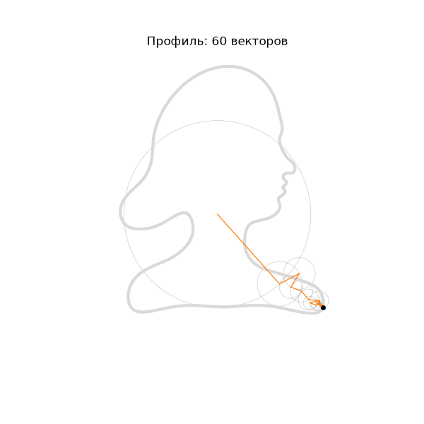
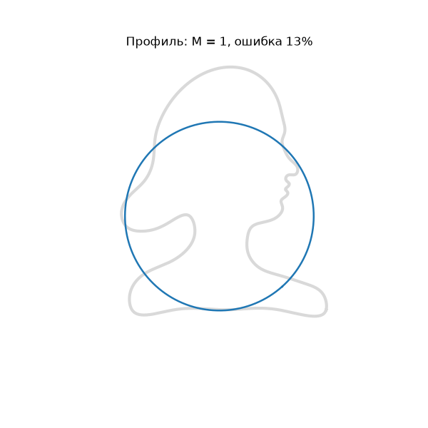
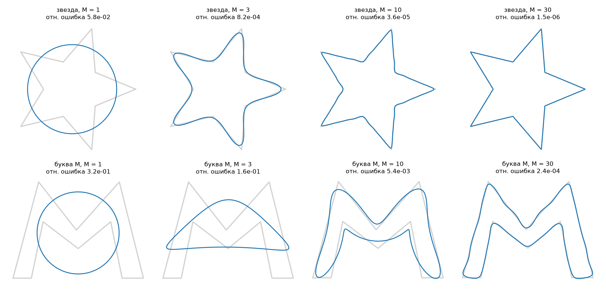
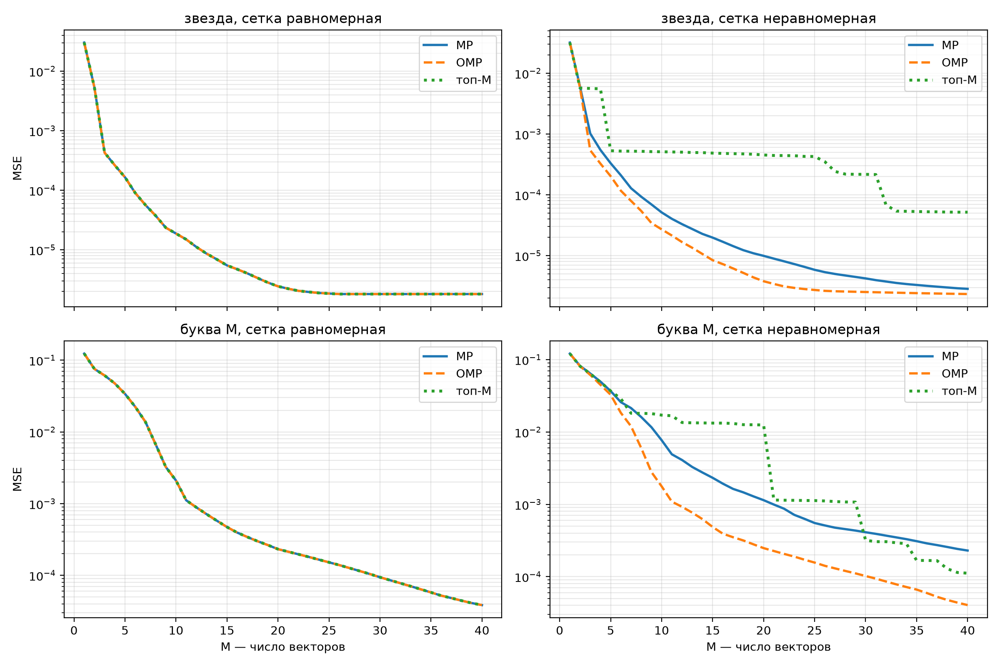
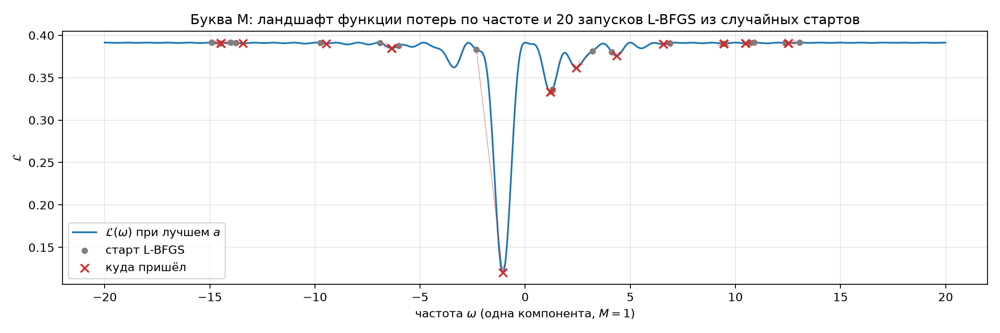
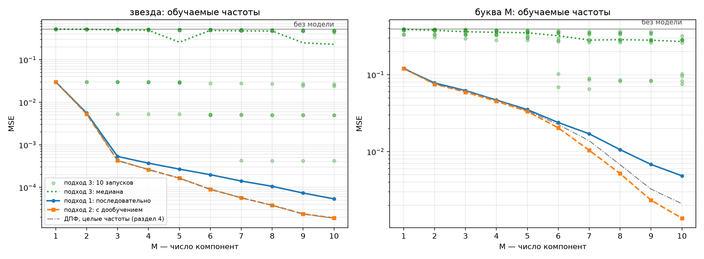
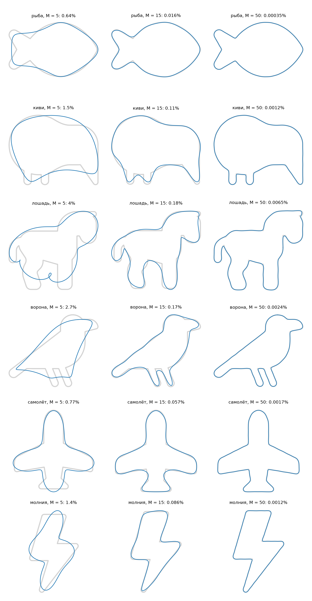
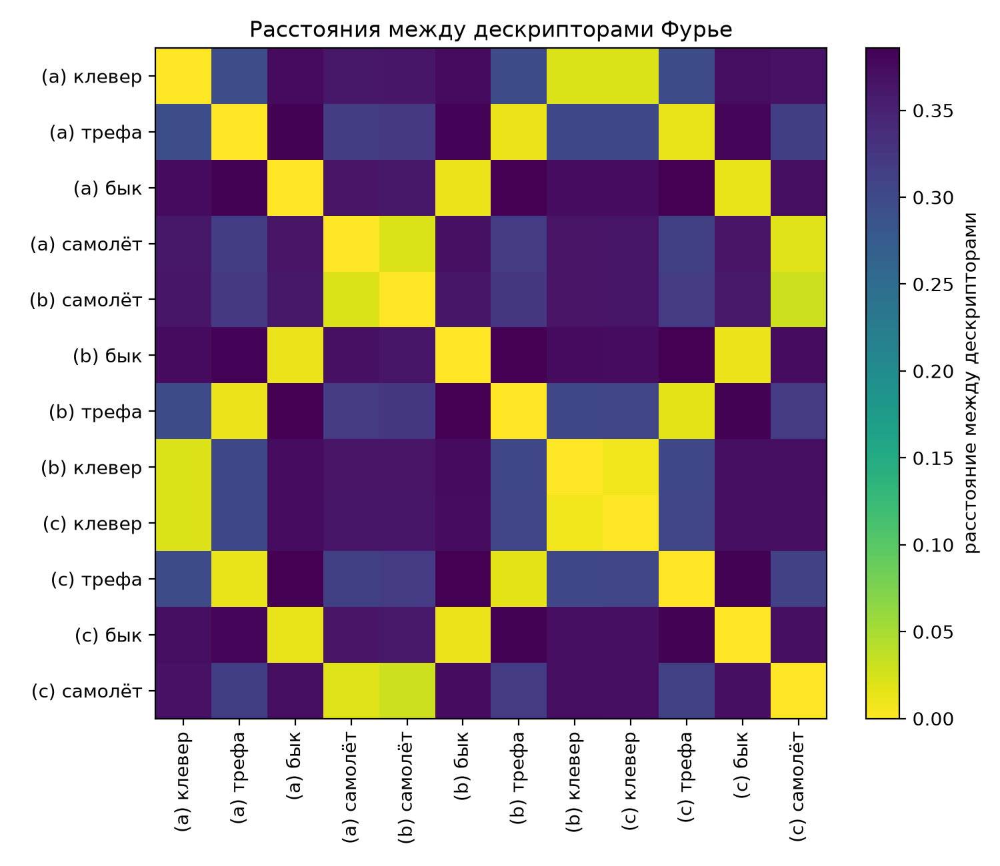

# Аппроксимация рисунка рядом Фурье: три способа подбора параметров

Рисунок на плоскости, нарисованный одним росчерком, записывается как сумма вращающихся векторов (эпициклов) — ряд Фурье. В работе сравниваются три способа подбирать параметры такого приближения и объясняется, когда и почему они дают разный результат.

<p align="center">
  
  
</p>

## Задача

Задан рисунок на плоскости, нарисованный одним росчерком, без самопересечений. Аппроксимировать его рядом Фурье, подбирая параметры:

1. последовательно;
2. последовательно, с дообучением параметров ранее добавленных компонент;
3. задав число компонент и обучив все параметры сразу.

Сравнить и проанализировать подходы.

## Главное

- **Целые частоты, равномерная сетка — три подхода совпадают и оптимальны.** Гармоники ортогональны, поэтому коэффициенты не зависят друг от друга, а ошибка равна сумме квадратов выброшенных коэффициентов (равенство Парсеваля). Это доказано (раздел 5) и проверено численно (раздел 6).
- **Неравномерная сетка — подходы расходятся.** Ортогональность ломается: дообучение (OMP) стабильно лучше последовательного подбора без дообучения (MP), а выбор всех частот сразу проигрывает обоим на порядок.
- **Обучаемые частоты — задача невыпуклая.** Обучение всех параметров из случайного старта почти всегда застревает в локальном минимуме. Последовательный подбор с дообучением — самый точный и надёжный.
- **Бонус:** модули коэффициентов Фурье не зависят от сдвига, масштаба, поворота и стартовой точки, и по ним распознаются все 8 фигур из задачи учебника по машинному зрению.

## Метод

Кривая — комплексная функция $z(t) = x(t) + i\,y(t)$, $t \in [0, 1)$. Её ряд Фурье

$$z(t) = \sum_{k} c_k\, e^{2\pi i k t}, \qquad c_k = \int_0^1 z(t)\, e^{-2\pi i k t}\, dt,$$

— это сумма векторов длины $|c_k|$, каждый из которых делает $k$ оборотов за период. По $N$ точкам, равномерно расставленным по длине кривой, коэффициенты даёт дискретное преобразование Фурье: `np.fft.fft(z) / N`.

**Три подхода как алгоритмы.** Подбор коэффициентов при заданных частотах — метод наименьших квадратов $\min_x \|z - Ax\|^2$, где столбцы $A$ — гармоники.

| подход | что делает |
|---|---|
| 1. последовательно — Matching Pursuit (MP) | на каждом шаге добавляет частоту с наибольшей проекцией остатка; старые коэффициенты не меняются |
| 2. с дообучением — Orthogonal MP (OMP) | то же, но после каждого шага пересчитывает **все** коэффициенты по МНК |
| 3. все сразу | выбирает набор из $M$ частот сразу и решает МНК |

**Теорема (раздел 5).** На равномерной сетке $A^H A = N I$, поэтому МНК по любому набору частот даёт коэффициенты ДПФ, и ошибка равна $\sum_{k \notin S} |c_k|^2$. Отсюда все три подхода выбирают $M$ наибольших $|c_k|$ и дают одно и то же, минимально возможное приближение.

**Обучаемые частоты (разделы 7–8).** Модель $\hat z(t) = \sum_j a_j e^{2\pi i \omega_j t}$ с $\omega_j \in \mathbb{R}$ обучается L-BFGS по аналитическому градиенту. По частоте функция потерь невыпуклая: для одной компоненты $\mathcal{L}(\omega) = \frac1N\|z\|^2 - |\hat c(\omega)|^2$, а $|\hat c(\omega)|$ ведёт себя как ядро Дирихле — узкие ямы шириной около 2 вокруг настоящих частот и плато с ложными минимумами между ними. Жадный подход находит каждую новую частоту перебором по сетке (глобальный поиск по одной переменной) и только потом уточняет её градиентом.

## Результаты

### Приближение $M$ векторами



Звезде хватает ~10 векторов, букве M — ~30. У звезды из-за симметрии ненулевые только частоты $k \equiv 1 \pmod 5$ (`figs/spectrum.png`).

### Эксперимент A: фиксированные целые частоты



MSE для буквы M, словарь частот $-64..64$:

| сетка | $M$ | MP | OMP | топ-$M$ + МНК |
|---|---|---|---|---|
| равномерная | 10 | 2.10e-3 | 2.10e-3 | 2.10e-3 |
| равномерная | 20 | 2.32e-4 | 2.32e-4 | 2.32e-4 |
| неравномерная | 10 | 7.69e-3 | **1.77e-3** | 1.71e-2 |
| неравномерная | 20 | 1.14e-3 | **2.48e-4** | 1.25e-2 |

На равномерной сетке три подхода совпадают до машинной точности. На неравномерной гармоники неортогональны (`figs/gram.png`), и OMP выигрывает.

### Эксперимент B: обучаемые частоты



Ландшафт функции потерь по частоте для буквы M: из 20 запусков L-BFGS со случайных стартов в глобальную яму попал один.



MSE при $M = 10$:

| кривая | подход 1 | подход 2 | подход 3: лучший из 10 | подход 3: медиана | ДПФ, целые частоты | без модели |
|---|---|---|---|---|---|---|
| звезда | 5.35e-5 | **1.90e-5** | 4.20e-4 | 2.29e-1 | 1.88e-5 | 5.22e-1 |
| буква M | 4.83e-3 | **1.36e-3** | 7.53e-2 | 2.70e-1 | 2.10e-3 | 3.91e-1 |

Медиана подхода 3 близка к уровню «без модели». Подход 2 у звезды находит её точный спектр ($1, -4, 6, -14, 16, \dots$), а у буквы M даже обходит ДПФ за счёт нецелых частот — ценой того, что приближение перестаёт быть замкнутым.

### Галерея контуров



| рисунок | $M$ для ошибки 1% | $M$ для 0.1% | наклон $\log\lvert c_k\rvert$ | подход 1, $M=10$ | подход 2, $M=10$ | подход 3: лучший |
|---|---|---|---|---|---|---|
| рыба | 5 | 11 | −2.01 | 8.98e-4 | **4.37e-4** | 5.74e-3 |
| киви | 7 | 16 | −2.12 | 2.46e-3 | **1.16e-3** | 1.83e-2 |
| лошадь | 9 | 18 | −2.15 | 2.95e-3 | **1.78e-3** | 1.11e-2 |
| ворона | 11 | 17 | −2.09 | 3.34e-3 | **1.53e-3** | 2.42e-2 |
| самолёт | 5 | 11 | −2.16 | 8.35e-4 | **3.47e-4** | 6.58e-3 |
| молния | 6 | 15 | −2.30 | 7.84e-4 | **6.45e-4** | 3.79e-2 |

У всех силуэтов есть углы, поэтому $|c_k| \sim 1/k^2$ — наклон около $-2$, как предсказывает теория. Выводы о трёх подходах повторяются на каждом рисунке.

**Профиль-портрет** (раздел 9.5): относительная ошибка 1% достигается уже при $M = 8$, но лица на этом приближении ещё нет — нос появляется к $M \approx 40$, губы к $M = 70$–$100$. Малая MSE не означает «похоже на глаз».

### Распознавание фигур по дескрипторам Фурье



Фигуры с рисунка 6.17 учебника *Machine Vision* (Jain, Kasturi, Schunck): четыре эталона, их масштабированные и повёрнутые версии. Дескриптор — нормированный вектор $|c_k|$, $k = \pm 1..\pm 20$. Ближайший эталон найден верно для **8 из 8** фигур: расстояние между копиями одной фигуры 0.008–0.03, между разными — 0.30–0.39.

## Содержание ноутбука

| раздел | что внутри |
|---|---|
| 1. Ряд Фурье и эпициклы | кривая как $z(t)$, эллипс как два вектора |
| 2. Дискретный случай | ДПФ по точкам, тонкости `numpy.fft` |
| 3. Данные | звезда, свой рисунок из SVG, ресэмплинг по длине дуги |
| 4. Приближение $M$ векторами | качество, равенство Парсеваля, спектр и симметрия, эпициклы |
| 5. Почему три подхода совпадают | МНК, ортогональность, три алгоритма, теорема с доказательством |
| 6. Эксперимент A | фиксированные частоты на равномерной и неравномерной сетке |
| 7. Обучаемые частоты: теория | модель, градиенты, ландшафт, гипотеза |
| 8. Эксперимент B | проверка градиента, ландшафт, три подхода с L-BFGS |
| 9. Другие рисунки | шесть силуэтов, портрет, GIF, распознавание фигур из учебника |
| 10. Выводы | итоги и рекомендации |

## Как запустить

```bash
git clone https://github.com/lvbealr/contour-fourier-approx.git
cd contour-fourier-approx
python -m venv .venv
source .venv/bin/activate
pip install -r requirements.txt
jupyter notebook fourier.ipynb
```

## Структура репозитория

```
fourier.ipynb       ноутбук: теория, код, эксперименты, выводы
requirements.txt    зависимости
example/            входные рисунки (SVG и PNG)
figs/               все графики и анимации, которые строит ноутбук
```

## Источники

**Рисунки в `example/`**
- `fish.svg`, `kiwi-bird.svg`, `horse.svg`, `crow.svg` — [Font Awesome Free](https://fontawesome.com) 6.7.2, лицензия [CC BY 4.0](https://creativecommons.org/licenses/by/4.0/), © Fonticons, Inc.
- `airplane.svg`, `lightning.svg` — [Bootstrap Icons](https://icons.getbootstrap.com), лицензия MIT.
- `jain_fig6_17.png` — рисунок 6.17 из главы 6 «Contours» книги R. Jain, R. Kasturi, B. G. Schunck, *Machine Vision*, McGraw-Hill, 1995 ([PDF главы](https://cse.usf.edu/~r1k/MachineVisionBook/MachineVision.files/MachineVision_Chapter6.pdf)); используется в учебных целях со ссылкой на источник.
- `test_m.svg`, `portrait.svg` — нарисованы для этой работы.

**Литература и материалы**
- 3Blue1Brown, [But what is a Fourier series? From heat flow to drawing with circles](https://www.3blue1brown.com/lessons/fourier-series).
- F. P. Kuhl, C. R. Giardina, [Elliptic Fourier features of a closed contour](https://doi.org/10.1016/0146-664X(82)90034-X), *Computer Graphics and Image Processing*, 1982.
- Y. C. Pati, R. Rezaiifar, P. S. Krishnaprasad, Orthogonal Matching Pursuit: Recursive Function Approximation with Applications to Wavelet Decomposition, 1993.
- B. Hayes, C. Saitis, G. Fazekas, [Sinusoidal Frequency Estimation by Gradient Descent](https://arxiv.org/abs/2210.14476), 2022.
